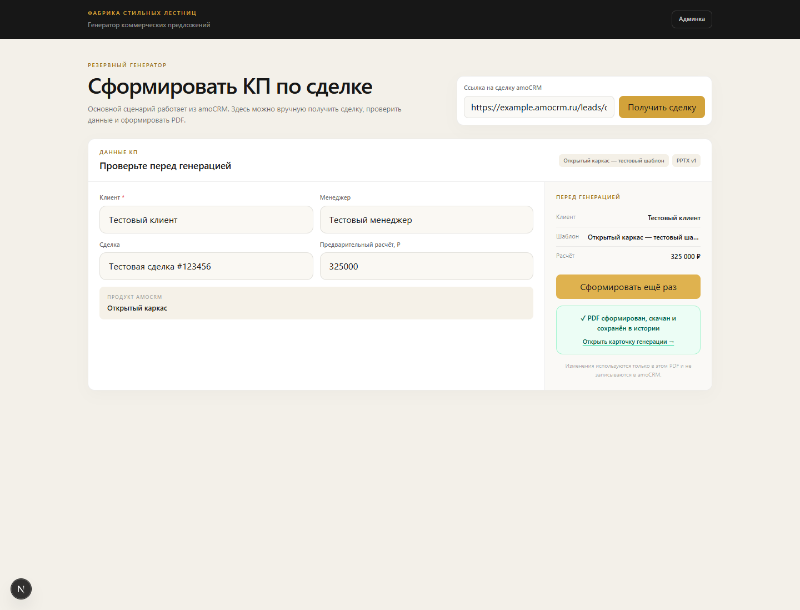
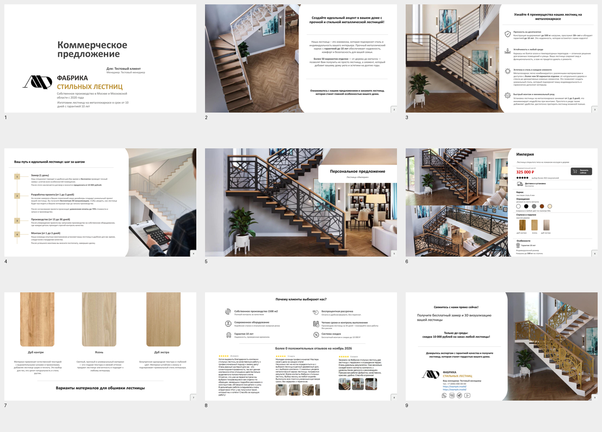

# Генератор коммерческих предложений — демонстрация

Материалы проверки проекта **Stairs KP / «Фабрика стильных лестниц»**. Проверка выполнена 22 ноября 2026 года на отдельном локальном стенде с вымышленными данными.

## Посмотреть результат

- **[Открыть тестовое КП — PDF, 9 страниц](demo-commercial-proposal.pdf)**
- **[Скачать PDF](https://github.com/Sergey5073434/fsl-kp-demo/raw/refs/heads/main/demo-commercial-proposal.pdf)**
- [Форма с загруженной тестовой сделкой](images/demo-form-ready.png)
- [Успешная генерация и сохранение в истории](images/demo-form-success.png)
- [Обзор всех девяти страниц КП](images/demo-pdf-contact.png)

## Что проверили

1. Восстановили актуальную рабочую копию из передачи с проверкой контрольных сумм.
2. Подняли отдельную базу и применили 14 миграций приложения.
3. Включили встроенный mock-режим, назначили шаблон «Империя» одному тестовому продукту.
4. Получили через интерфейс вымышленную сделку: тестовый клиент, тестовый менеджер, сумма 325 000 ₽.
5. Сформировали PPTX и PDF через установленный PowerPoint, скачали PDF обычной кнопкой интерфейса.
6. Открыли сохранённую генерацию в истории, раздел продуктов и системный раздел.
7. Повторно запустили стенд и подтвердили сохранность созданного КП.

33 модульных теста и проверка типов прошли. В браузерном сценарии не обнаружено ошибок JavaScript и запросов к внешним адресам. В итоговом PDF подставлены имя клиента, менеджер и сумма; незаполненные `{{...}}` отсутствуют. Линт рабочего кода без ошибок, с тремя существующими предупреждениями виджета; распакованные исторические архивы исключены из этой проверки.

## Границы демонстрации

Это **материалы демонстрации**, а не размещённая в интернете рабочая форма генератора. Сам тестовый экземпляр работает локально. GitHub не запускает его базу и конвертер PDF.

Реальная amoCRM не подключалась, рабочий сервер не менялся, КП клиентам не отправлялось. Фотографии и статические тексты в примере взяты из присланного шаблона и отдельно не утверждались. Пример предназначен для проверки формирования документа.

## Скриншоты

### Проверка данных перед генерацией

### PDF скачан и сохранён в истории

### Все страницы полученного КП

В этой поставке только демонстрационные материалы. Исходный архив, настройки, токены, база данных и рабочие PPTX-шаблоны не публикуются.
