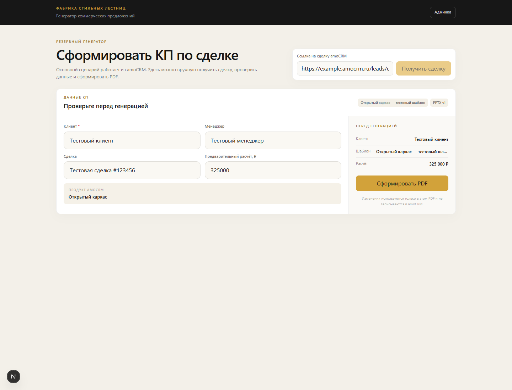

# Генератор коммерческих предложений

## Рабочая форма по ссылке

**[Открыть генератор КП](https://Sergey5073434.github.io/fsl-kp-demo/)**

Менеджер заполняет клиента, готовую сумму расчёта, своё имя и контакты, затем нажимает «Сформировать PDF». Скачивается персональное КП на девяти страницах по шаблону «Империя».

Форма работает на GitHub Pages: PDF создаётся прямо в браузере, без обращения к локальному компьютеру. Введённые данные никуда не отправляются. Все библиотеки и шрифты размещены рядом с формой; внешние CDN не используются.

Доступен один шаблон, ручной ввод и скачивание PDF. Подключение amoCRM, общая история и админка исходного Stairs KP требуют отдельного серверного развёртывания. Тексты и изображения исходного шаблона необходимо проверить перед отправкой реальным клиентам.

Исходники публичной формы: index.html, style.css, app.js. Она заполняет очищенный PDF-макет и не запускает Next.js/Prisma/PPTX-конвертер на GitHub Pages.

---

Материалы проверки проекта **Stairs KP / «Фабрика стильных лестниц»**. Проверка выполнена 22 ноября 2026 года на отдельном локальном стенде с вымышленными данными.

## Посмотреть результат

- **[Открыть тестовое КП — PDF, 9 страниц](demo-commercial-proposal.pdf)**
- **[Скачать PDF](https://github.com/Sergey5073434/fsl-kp-demo/raw/refs/heads/main/demo-commercial-proposal.pdf)**
- [Форма с загруженной тестовой сделкой](images/demo-form-ready.png)
- [Успешная генерация и сохранение в истории](images/demo-form-success.png)
- [Обзор всех девяти страниц КП](images/demo-pdf-contact.png)

## Что проверили

1. Восстановили актуальную рабочую копию из передачи с проверкой контрольных сумм.
2. Подняли отдельную базу и применили 14 миграций приложения.
3. Включили встроенный mock-режим, назначили шаблон «Империя» одному тестовому продукту.
4. Получили через интерфейс вымышленную сделку: тестовый клиент, тестовый менеджер, сумма 325 000 ₽.
5. Сформировали PPTX и PDF через установленный PowerPoint, скачали PDF обычной кнопкой интерфейса.
6. Открыли сохранённую генерацию в истории, раздел продуктов и системный раздел.
7. Повторно запустили стенд и подтвердили сохранность созданного КП.

33 модульных теста и проверка типов прошли. В браузерном сценарии не обнаружено ошибок JavaScript и запросов к внешним адресам. В итоговом PDF подставлены имя клиента, менеджер и сумма; незаполненные `{{...}}` отсутствуют. Линт рабочего кода без ошибок, с тремя существующими предупреждениями виджета; распакованные исторические архивы исключены из этой проверки.

## Границы демонстрации

Ниже сохранены материалы первоначальной проверки оригинального Stairs KP. Его серверная версия остаётся отдельным локальным экземпляром. Публичная форма по ссылке выше — самостоятельный режим ручного заполнения.

Реальная amoCRM не подключалась, рабочий сервер не менялся, КП клиентам не отправлялось. Фотографии и статические тексты в примере взяты из присланного шаблона и отдельно не утверждались. Пример предназначен для проверки формирования документа.

## Скриншоты

### Проверка данных перед генерацией

### PDF скачан и сохранён в истории

### Все страницы полученного КП

Исходный архив серверной версии, настройки, токены, база данных и рабочие PPTX-шаблоны не публикуются. Браузерный шаблон подготовлен отдельно: удалены прежние персональные значения и старые ссылки. Зависимости: pdf-lib 1.17.1, @pdf-lib/fontkit 1.1.1 (MIT), Golos Text (SIL OFL); лицензии в assets/.
